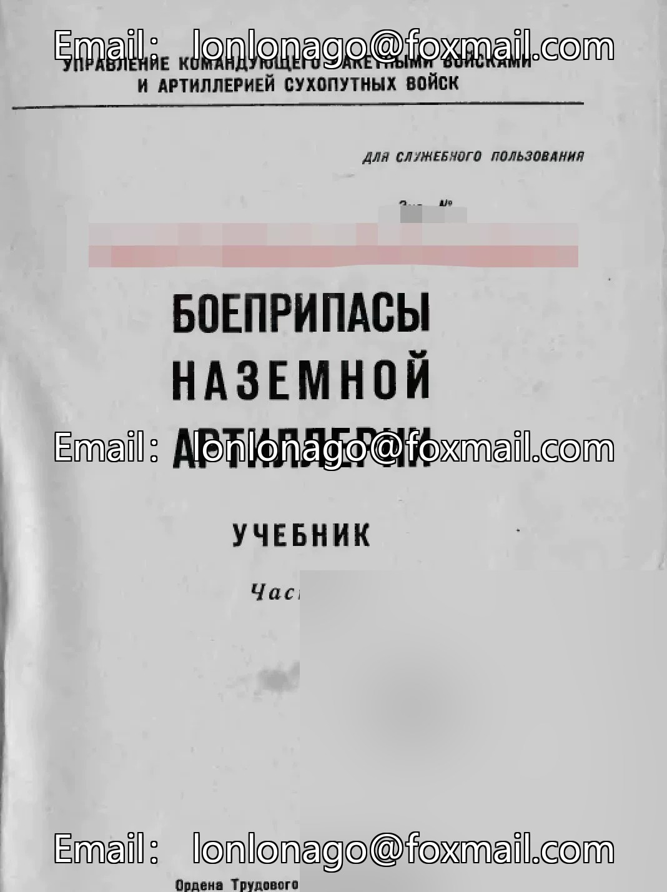
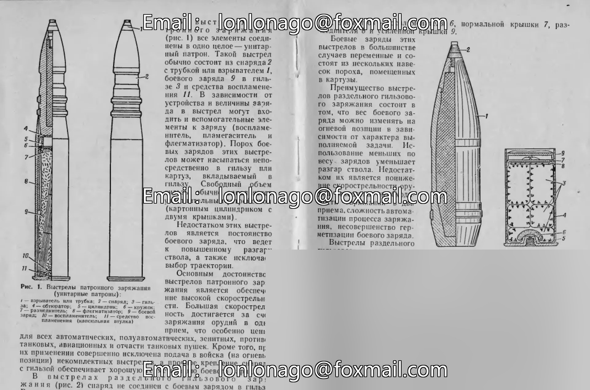
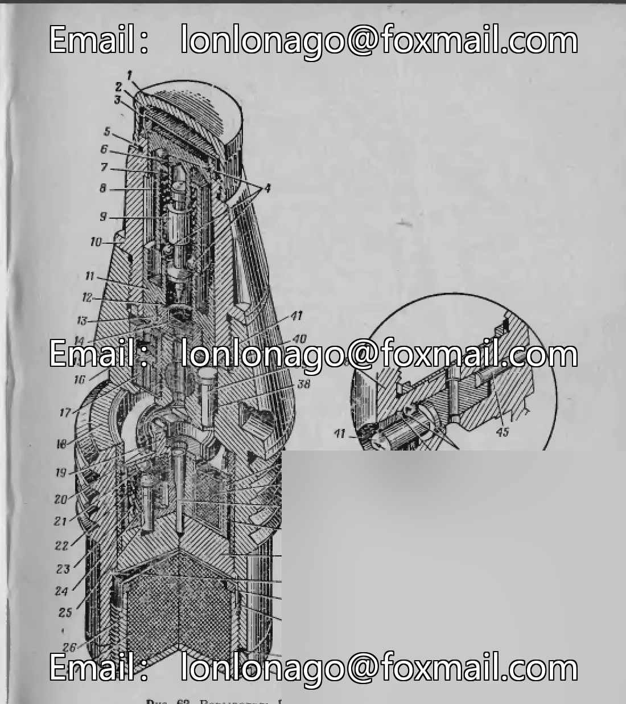
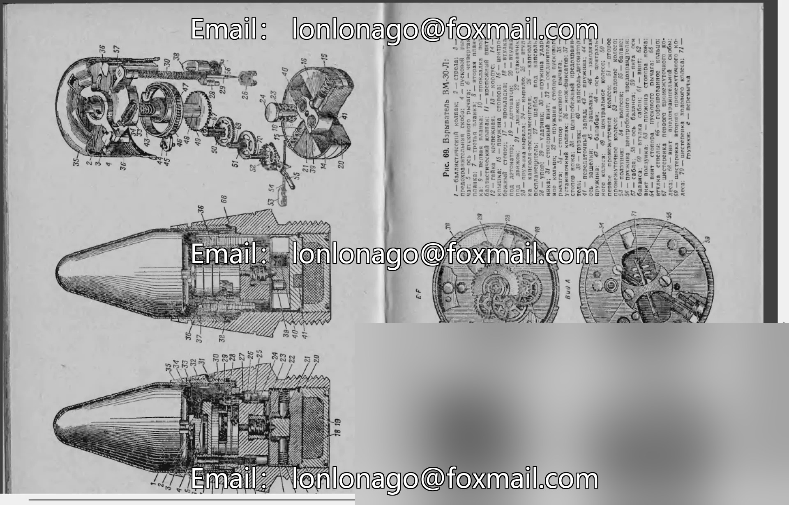
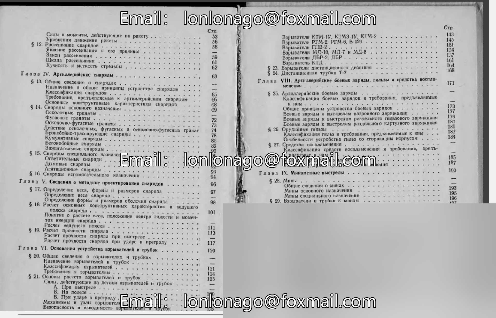

# Soviet/ Russian Army military textbook 《BOBEPRIPASY NAZEMN》

## Body

Soviet/Russian Army military textbook "Boeiprasi Nasemoy Artileryrnii" (Ground Artillery Ammunition) .
The complete content includes detailed explanations of basic knowledge, structure and performance, and combat usage of various types of ammunition. Suitable for military enthusiasts and professional research.
The are copyable and no replacement is issued upon sale.

This is a Soviet/Russian army military textbook covering ground cannon ammunition: basic knowledge, structure and performance, and combat usage, aimed at military enthusiasts and professional research.

<!-- AI_ENRICHED -->

## Images

## Payment

Here is a pay link on Stripe ( https://buy.stripe.com/3cs8yP7sY87d0vu9AB ). Please contact me lonlonago@foxmail.com after funding $89, and I will send you a complete data files , thank you!

